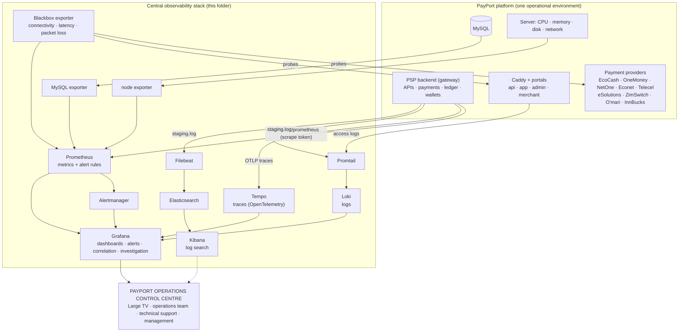

# PayPort Operations Control Centre

One overview on the TV, five detailed dashboards for the operations team. The TV rotates through the five
dashboards on its own (one minute each); anyone can open a single dashboard in Grafana to investigate.

## Architecture

| Piece | What it does for PayPort |
|---|---|
| **Gateway metrics** | JVM, every API request (response times by route and status), database pool, and the Control Centre figures the gateway computes every 30 seconds from its own tables: transactions today by outcome and channel, transactions per minute, success rate, pending and uncertain payments, provider availability (from the real provider checks), provider success rate and payment latency, refunds, reversals waiting, settlement batches, reconciliation exceptions, callbacks rejected and repeated, webhook deliveries, fraud alerts, complaints, privileged actions. Counts only: no references, phone numbers or names. |
| **Security events** | Counted where they happen: failed logins (customer and staff), wrong PINs, locked accounts, rate-limit violations, permission refusals, invalid webhook signatures, repeated (idempotent) requests. |
| **Prometheus** | Collects all metrics every 15 s and evaluates the alert rules (`prometheus/rules/payport.yml`). |
| **Blackbox exporter** | TCP connect and ICMP (latency, packet loss) to every provider the gateway is configured with, HTTP checks of the provider callback addresses and of PayPort's public sites. Provider targets are discovered from the gateway (`/api/v1/monitoring/targets`), so they always match its configuration. |
| **node / MySQL exporters** | Server CPU, memory, disk, network; database health, connections, slow queries. |
| **Loki + Promtail** | Gateway and Caddy logs, searchable from Grafana; phone numbers and bearer tokens are masked before they leave the server. |
| **Tempo** | Request traces from the gateway (OpenTelemetry Java agent): a slow payment can be followed across the gateway, the database and the provider call. |
| **Elasticsearch + Kibana** (optional) | Full-text log search and Kibana's discovery views, fed by Filebeat with the same masking. Overlaps with Loki; kept as an option because it needs about 2.5 GB of memory. |
| **Grafana** | The five dashboards, the TV playlist, alerting views and links between metrics, logs and traces. |

## The five dashboards

1. **Executive Operations Overview**: overall platform status, transactions today, successful/failed/pending,
   success rate, processing volume, current system alerts, active incidents, provider availability, complaints.
2. **Infrastructure and Network**: server and service availability, CPU, memory, disk space, network bandwidth,
   latency, packet loss, database health and connections, API response times, connectivity between services, JVM.
3. **Payment Processing**: transactions per minute, success and failure, pending and uncertain transactions,
   payment latency, provider-by-provider performance, duplicate attempts, refund activity, settlement status,
   reconciliation exceptions, split by channel.
4. **Security and Risk**: failed logins, suspicious API activity, rate-limit violations, authentication failures,
   fraud alerts, unusual transaction patterns (now versus usual), privileged access activity, security incidents,
   security log.
5. **Integrations and Providers**: provider API health (real requests) and network connectivity, bank and rail
   availability, provider response times and packet loss, callback addresses, callbacks rejected and repeated,
   merchant webhook delivery, failed integration requests, reconciliation exceptions, integration error log.

## Set-up (staging server, about 1 GB of memory; 3.5 GB with Kibana)

The staging server is already tight on memory (the admin portal build needed extra). Run the stack on a separate
small server (2 vCPU / 4 GB, 8 GB with Kibana) if you can; on the same server it works as below. On a separate
server, change `127.0.0.1:8085` in `prometheus/prometheus.yml` to the gateway's private address and point
`OTEL_EXPORTER_OTLP_ENDPOINT` at the monitoring server.

1. Gateway: add a scrape token to `/opt/payport/staging/.env.staging` and restart the gateway:
   `PAYPORT_METRICS_TOKEN=$(openssl rand -hex 32)`
2. MySQL: create the read-only monitor user (edit the password first): `mysql -u root -p < mysql-monitor-user.sql`
3. Docker (if not installed): `curl -fsSL https://get.docker.com | sh`
4. `cd /opt/payport/staging/ops/observability && cp .env.example .env && chmod 600 .env`, fill in the passwords,
   then `sudo scripts/setup.sh` (asks for the MySQL monitor password, starts everything, creates the TV playlist and
   prints the TV address).
5. Caddy: copy `caddy/monitor.caddy` to `/etc/caddy/`, add `import /etc/caddy/monitor.caddy` to the Caddyfile,
   point DNS for `monitor-staging.payport.africa` at the server, `sudo systemctl reload caddy`.
6. Traces (optional): download the OpenTelemetry Java agent to `/opt/payport/otel/opentelemetry-javaagent.jar` and add
   `OTEL_AGENT_JAR=/opt/payport/otel/opentelemetry-javaagent.jar` to `.env.staging`; restart the gateway.
7. Kibana (optional): set `ELASTIC_PASSWORD` and `KIBANA_SYSTEM_PASSWORD` in `.env`, run
   `docker compose --profile kibana up -d`, set the kibana_system password once
   (`docker compose exec elasticsearch bin/elasticsearch-reset-password -u kibana_system -i`), and enable the Kibana
   block in `caddy/monitor.caddy`.

## The TV

Open the address `scripts/setup-tv.sh` prints (`…/playlists/play/<id>?kiosk`) in the TV's browser, logged in as the
read-only `tv` user. Kiosk mode hides Grafana's menus; the playlist moves to the next dashboard every minute
(`scripts/setup-tv.sh 30` for 30 seconds). Dashboards refresh every 30 seconds.

## Security

- Every service listens on 127.0.0.1 only. Grafana and Kibana are reached through Caddy (HTTPS) with their own logins;
  sign-up and anonymous access are off. The TV uses a read-only account.
- The gateway's metrics endpoints need the scrape token; without one configured they do not exist.
- Metrics carry counts only. Logs are masked (phone numbers, bearer tokens) before they are shipped.
- `.env` and `secrets/` are never committed (`.gitignore`).

## What has been checked

- Prometheus configuration and the 20 alert rules: `promtool check config` / `check rules` pass.
- All 92 dashboard queries parse in Prometheus 2.55.
- Alertmanager (`amtool`), Blackbox, Loki (`-verify-config`) and Promtail (`-check-syntax`) accept their configurations;
  Tempo and Loki start and listen on 127.0.0.1 only.
- Log shipping end to end (Promtail → Loki): levels labelled, stack traces kept together, phone numbers and tokens masked.
- The gateway's new metrics are tested in CI (`SecurityResilienceScenarioTest`).
- Not run here: Grafana itself (its download is blocked from the build environment), Docker Compose, Elasticsearch,
  Kibana and the TV playlist. They are standard images and API calls, but the first start on the server is the first
  real run.
